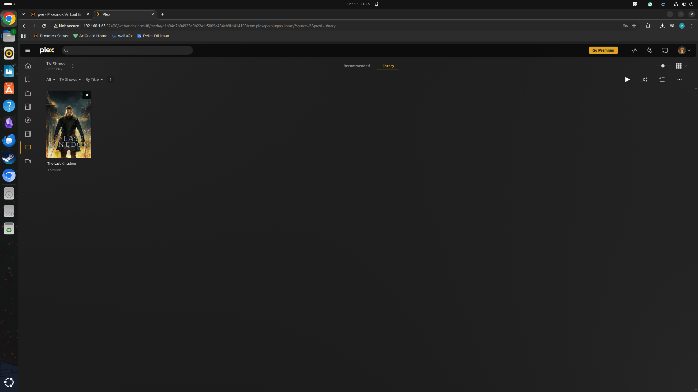
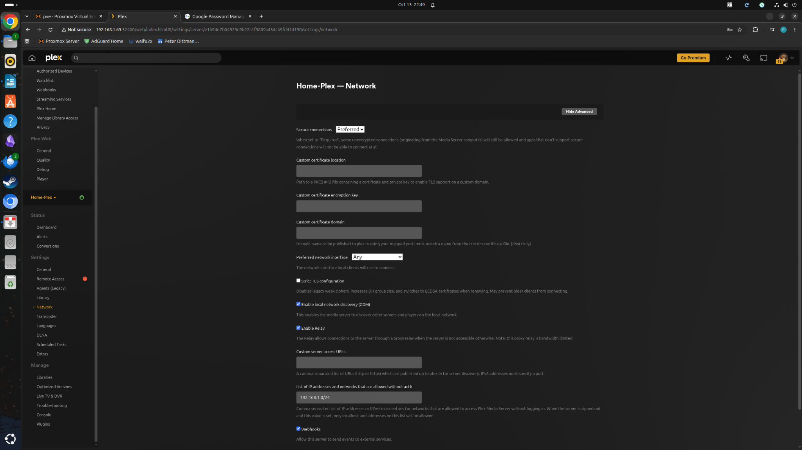
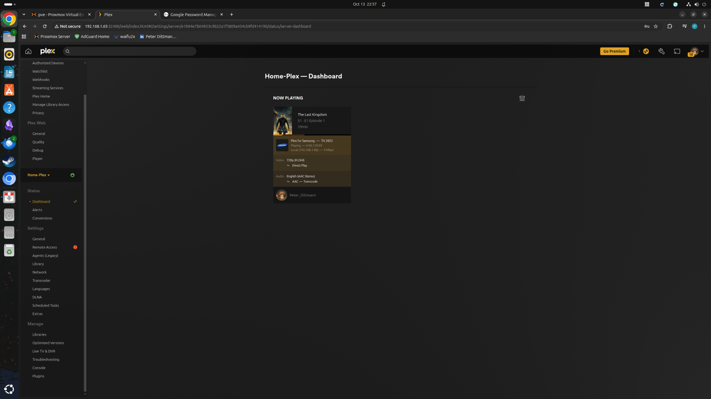
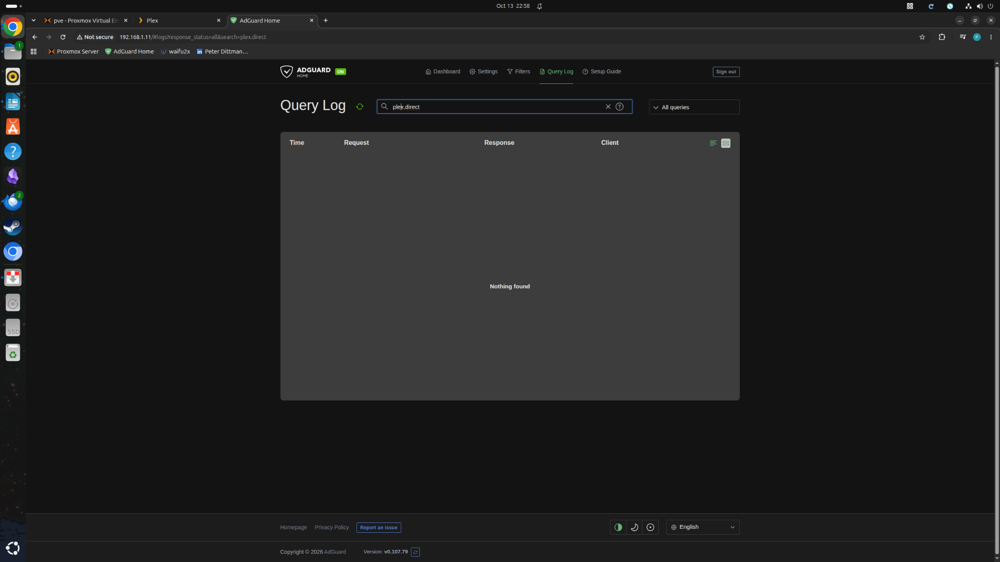

# Plex Media Server on Proxmox — Deployment and Samsung TV Playback Troubleshooting

**Lab type:** Personal homelab, independently configured with troubleshooting guidance  
**Date documented:** October 2026  
**Status:** Plex running; playback working on Samsung TV; exact DNS failure mechanism not proven

## Why I set this up

I wanted to make better use of my Proxmox server and have a local place to keep and stream my own media. Plex seemed like a practical project because it involved more than installing an application. I needed to work with an LXC container, an external disk, Linux permissions, networking, and a client device that wasn't guaranteed to behave like my desktop.

The installation worked, but getting playback working on the Samsung TV turned into the more useful part of the lab.

## Environment

| Component | Configuration observed during this lab |
| --- | --- |
| Host | Lenovo desktop, Proxmox VE 9.2.18, Intel i5-4570, 16 GB RAM |
| Plex workload | CT 104, Debian-based unprivileged LXC; 2 vCPUs, 2 GiB RAM, 512 MiB swap, 24 GiB root disk |
| Plex address | `192.168.1.65:32400` (DHCP address observed during testing) |
| External media disk | ~1.4 TB ext4 filesystem, label `PlexMedia`, mounted on host at `/mnt/plex-media` |
| Container media path | Host bind mount exposed at `/media` |
| Libraries | `Movies`, `TV-Shows`, `Home-Videos` |
| DNS service | AdGuard Home, CT 101, `192.168.1.11` |
| Test client | Samsung 2023 Tizen TV, `192.168.1.86` |
| LAN | `192.168.1.0/24` |

The IP addresses are snapshots of this private home network, not permanent service guarantees.

## Deployment and checks

I created a separate LXC container for Plex instead of adding it to my general Debian lab container. I attached an external ext4 disk to the Proxmox host, mounted it at `/mnt/plex-media`, and made it available to the Plex container at `/media`. I organised the media into separate library folders and added those paths in Plex.

The libraries populated with titles and metadata. I also checked that the media mount was visible inside CT 104 and that the container had sufficient free disk space and memory. These checks helped rule out a missing mount or an exhausted root filesystem when playback started failing.

I confirmed that both test shows played on my PC. That mattered: it showed the server could read the files and deliver a stream to at least one client.

## The playback problem

The Samsung Plex app could sign in, browse the server, and display the libraries, but starting an episode produced **“Playback Error — An unexpected playback problem occurred.”** I reproduced it with two different shows:

- *The Last Kingdom* — 720p H.264 in MKV, AAC audio.
- *Over the Garden Wall* — 1080p H.264 High 10 in MP4, AAC audio.

Because both titles failed on the TV but played on the PC, I didn't assume it was one bad media file. I also tried playback-quality changes, Direct Play options, a full TV restart, and reinstalling the Plex app. Those attempts didn't resolve it.

## How I narrowed it down

| Test or observation | Result | What I took from it |
| --- | --- | --- |
| Play same titles on PC | Worked | Plex and media files were usable by another client |
| Play on Samsung TV with normal settings | Failed | Issue was specific to the TV playback path |
| Review Plex dashboard and logs | TV session started, then stopped quickly; TLS warning also appeared | Server received the request, but the logs did not prove the cause |
| Check container RAM, disk space, transcode directory | No obvious capacity or permission issue found | Resource exhaustion was not the leading explanation |
| Samsung **Allow Insecure Connections = Always** | Both shows played | Connection policy or discovery was implicated |
| Restore **Prefer Insecure Connections = On same network**, leave Allow = Always | Still played | The Prefer setting was not necessary for the workaround |
| Restore **Allow Insecure Connections = On same network** | Failed again | The Allow setting was the decisive client-side difference in that test |
| Add local subnet to Plex server configuration | No improvement | Did not fix playback; see security correction below |
| Test without global IPv6 on Plex container | Still failed | IPv6 was unlikely to explain the problem by itself |
| Check Plex dashboard while TV played | Marked **Local (`192.168.1.86`)**; video Direct Play; audio transcoding | Plex recognised the client as local and streaming/transcoding worked |
| Search AdGuard query log for `plex.direct` | No matching entries at that moment | Did not prove DNS was healthy or broken; TV was using router DNS |
| Change Samsung TV DNS from router to AdGuard (`192.168.1.11`) | Playback worked with both insecure settings back to **On same network** | Strong evidence that the DNS path mattered |

I changed one setting at a time where possible and retested. That made it easier to distinguish what actually affected playback from what only looked suspicious in the logs.

## Resolution and limits of the conclusion

The successful change was pointing the Samsung TV at my AdGuard Home DNS server (`192.168.1.11`) instead of the router's DNS. After that, *The Last Kingdom* played with **Allow Insecure Connections** and **Prefer Insecure Connections** both set to **On same network**.

My working explanation is that the router's DNS behaviour interfered with how the Samsung Plex app discovered or connected to the server. Plex uses `plex.direct` hostnames for secure local connections, so DNS resolution or DNS-rebinding protection is worth investigating. **I did not capture a failed DNS lookup or prove exactly what the router was doing.** I also did not prove that the successful stream used TLS; “On same network” still allows insecure local connections.

This is a working resolution, not a verified root-cause analysis.

## Security correction

During troubleshooting I briefly put `192.168.1.0/24` into Plex's **List of IP addresses and networks that are allowed without auth**. That is an authentication-bypass setting, **not** the intended LAN classification control. It should be cleared and saved. The screenshots record the troubleshooting state and should not be copied as a recommended final configuration.

I also temporarily used **Allow Insecure Connections = Always** on the TV to isolate the issue. I returned it to **On same network** after the DNS change worked. That setting still permits insecure connections on the local network; it is not proof of encrypted playback.

## Verification and remaining work

**Verified:** the server is accessible; the external media library is readable; Plex identifies the Samsung TV as local; a successful Samsung playback session shows H.264 video Direct Play and AAC audio transcoding; playback works after the TV DNS change.

**Still worth checking:** confirm the Plex authentication-bypass list is empty, confirm IPv6 was restored to its previous configuration, verify the second show again after the DNS change, and inspect `plex.direct` DNS answers or TLS behaviour if the problem returns. I have not documented backup or recovery for the Plex database or the media disk in this lab.

## Evidence gallery

The following are selected screenshots from the deployment and investigation, rather than a complete transcript. Some screenshots show intermediate or unsuccessful configurations.

| # | Evidence | File |
| --- | --- | --- |
| 01 | [CT 104 network configuration](../images/plex/01-plex-container-network.png) | `01-plex-container-network.png` |
| 02 | [External storage shown in Proxmox](../images/plex/02-external-disk-proxmox.png) | `02-external-disk-proxmox.png` |
| 03 | [Mount and filesystem validation](../images/plex/03-media-mount-validation.png) | `03-media-mount-validation.png` |
| 04 | [Plex library populated](../images/plex/04-plex-library.png) | `04-plex-library.png` |
| 05 | [Plex playback dashboard during troubleshooting](../images/plex/05-playback-dashboard-initial.png) | `05-playback-dashboard-initial.png` |
| 06 | [Plex log investigation](../images/plex/06-server-log-investigation.png) | `06-server-log-investigation.png` |
| 07 | [Plex server network settings (pre-correction)](../images/plex/07-plex-network-settings.png) | `07-plex-network-settings.png` |
| 08 | [IPv6 addresses in Plex container](../images/plex/08-ipv6-addresses.png) | `08-ipv6-addresses.png` |
| 09 | [Container network IPv6 configuration](../images/plex/09-container-ipv6-settings.png) | `09-container-ipv6-settings.png` |
| 10 | [Global IPv6 address still assigned](../images/plex/10-ipv6-still-present.png) | `10-ipv6-still-present.png` |
| 11 | [Successful local Samsung playback](../images/plex/11-successful-local-playback.png) | `11-successful-local-playback.png` |
| 12 | [AdGuard query log search](../images/plex/12-adguard-query-log.png) | `12-adguard-query-log.png` |

### Key screenshots

## What I learned

This was a reminder not to confuse a working server with a working end-to-end service. Plex could scan the files, my PC could play them, and the TV could browse the library, but playback still failed. Checking the client, logs, connection settings, IP addressing, and DNS separately was more useful than reinstalling everything. The biggest lesson for me was to keep track of each test and be careful about security settings that appear to solve a connection problem.
